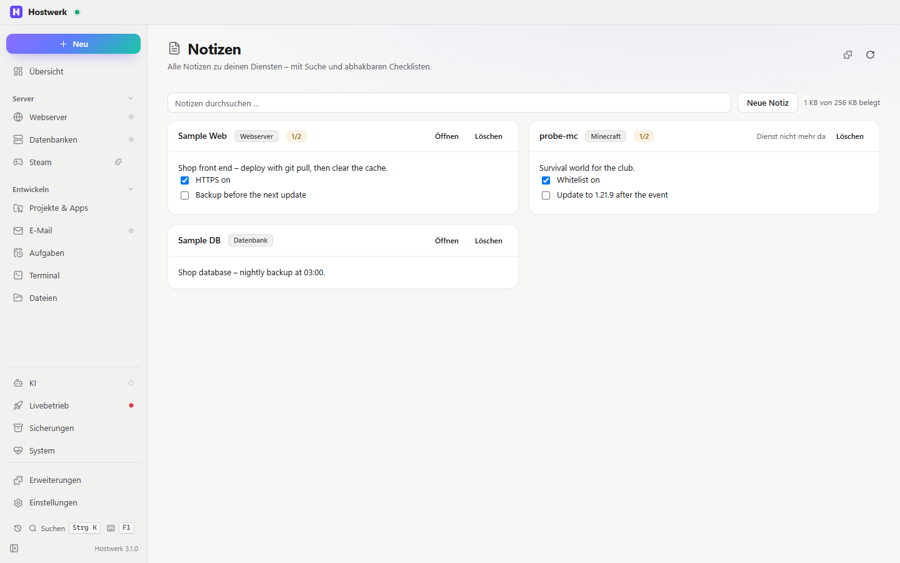

# Dienst-Notizen

Notizen und Checklisten zu jedem Dienst – als eigener Reiter auf jeder Detailseite und im Rechtsklick-Menü.

[English](README.md) · Offizielle [Hostwerk](https://github.com/Passimoritz/hostwerk-public)-Erweiterung (läuft abgeschottet, ab Hostwerk 2.9)

## Was sie kann

Dazu ein **Beispiel für eine Erweiterung, die Hostwerks eigene Seiten erweitert**:

- **Reiter auf jeder Detailseite** – Webserver, Datenbank, Minecraft, App, Spiele-Server (`contributes.tabs`), dazu einer im Mail-Bereich für den Mail-Fänger; Hostwerk übergibt den Dienst als `Hostwerk.context`.
- **„Notiz …“ in jedem Rechtsklick-Menü**, in der Schnellsuche und im **„Neu“-Menü** von Hostwerk (ohne Dienst wählst du erst einen), **„Alle Notizen“** in der Schnellsuche und auf **Strg+Alt+N** (`contributes.actions`, `contributes.new`, `contributes.shortcuts`).
- Speichert beim Tippen von selbst – beim Wechsel von Reiter oder Seite geht nichts verloren.
- Übersichtsseite mit Suche und Löschen (auch Notizen zu Diensten, die es nicht mehr gibt); Checklisten-Zeilen `- [ ] …` lassen sich abhaken.
- Einfache, sichere Formatierung: `**fett**`, Backticks für Code, `# Überschrift` und Weblinks (öffnen nach Rückfrage im Browser) – nichts in einer Notiz wird je zu HTML.
- Gespeichert bei Hostwerk (`Hostwerk.storage`, max. 256 KB) – die Seite zeigt, wie viel belegt ist, und sagt deutlich, wenn er voll ist. Alle, die dieses Hostwerk nutzen (auch dein Team), sehen dieselben Notizen.
- **Im Wissensgraph** (ab Hostwerk 3.0): jede Notiz wird ein Knoten, verknüpft mit den Projekten ihres Webservers bzw. ihrer App – Claude und die Wissensgraph-Seite finden sie zusammen mit dem Code.
- Andere Erweiterungen dürfen Reiter ergänzen (`"allowExtensions": { "*": ["tabs"] }`) – die [Zusatz-Vorlage](https://github.com/Passimoritz/hostwerk-ext-template-extend) setzt hier einen Reiter „Merkliste“ dazu.

## Installieren

In Hostwerk: **Erweiterungen → Entdecken** und „Installieren“ klicken. Oder von Hand: die Zip-Datei aus dem [neuesten Release](../../releases/latest) laden → *Erweiterungen → Hinzufügen → Datei*.

Sie läuft abgeschottet in Hostwerk – sie bekommt nur die Rechte, die sie nennt, und Hostwerk zeigt sie vor dem Installieren.

## Rechte

**Wo:** Reiter „Notizen“ jedes Dienstes – seit 1.3.1 ohne eigenen Seitenleisten-Eintrag; die ganze Seite bleibt unter Erweiterungen → Öffnen

| Recht | Wofür |
|---|---|
| `read:services` | Dienstnamen neben den Notizen anzeigen (auch Spiele-Server und Mail-Fänger) |
| `storage` | Notizen aufbewahren |
| `change:knowledge` | Notizen als Knoten in Hostwerks Wissensgraph eintragen (ab Hostwerk 3.0, ohne Rückfrage – nur die eigenen Daten des Graphen) |

## Entwickeln

Logik in `page/lib.js` (ohne DOM), Tests: `node --test tests/*.test.js`.

## Lizenz

MIT
